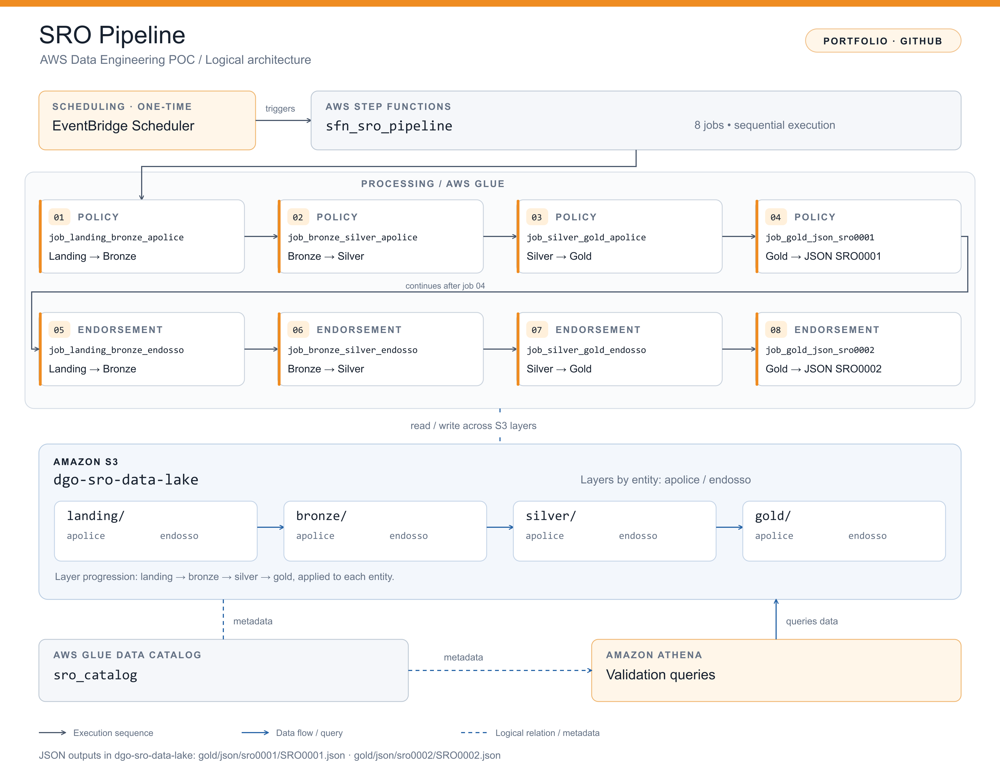
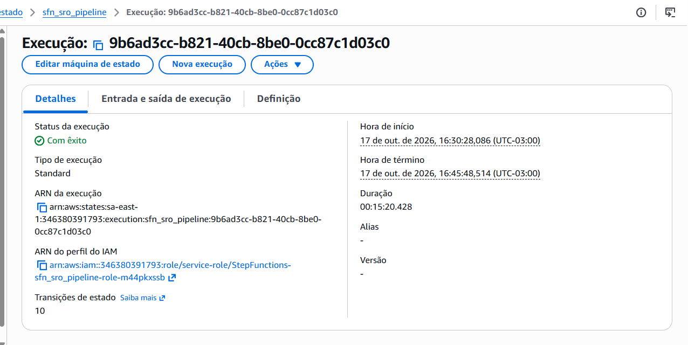
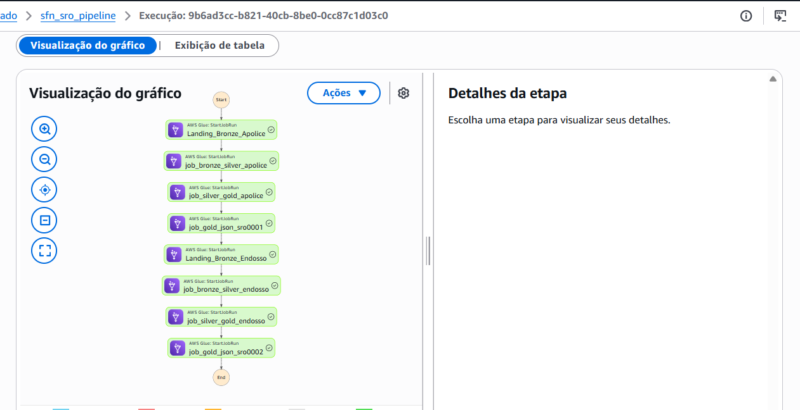

# AWS SRO Data Pipeline

AWS Data Engineering proof of concept for processing insurance policies (*apólices*) and endorsements (*endossos*).

The pipeline uses Amazon EventBridge Scheduler to trigger AWS Step Functions, which orchestrates eight sequential AWS Glue jobs. Data is organized into landing, bronze, silver, and gold layers in Amazon S3, with AWS Glue Data Catalog and Amazon Athena supporting data validation.

## Architecture

[View editable diagram (SVG)](sro-pipeline-architecture.svg)

- **Scheduling:** Amazon EventBridge Scheduler
- **Orchestration:** AWS Step Functions — `sfn_sro_pipeline`
- **Processing:** Eight sequential AWS Glue jobs
- **Storage:** Amazon S3 — `dgo-sro-data-lake`
- **Metadata:** AWS Glue Data Catalog — `sro_catalog`
- **Validation:** Amazon Athena

## Processing Sequence

| Step | AWS Glue Job |
| --- | --- |
| 1 | `Landing_Bronze_Apolice` |
| 2 | `job_bronze_silver_apolice` |
| 3 | `job_silver_gold_apolice` |
| 4 | `job_gold_json_sro0001` |
| 5 | `Landing_Bronze_Endosso` |
| 6 | `job_bronze_silver_endosso` |
| 7 | `job_silver_gold_endosso` |
| 8 | `job_gold_json_sro0002` |

## Data Lake Layers

Both entities follow the same logical progression:

`landing → bronze → silver → gold`

The final job for each entity generates its corresponding JSON: SRO0001 for policies and SRO0002 for endorsements.

## Scope

This repository documents the proof-of-concept architecture. JSON output destinations are not specified.

## Execution Evidence

The pipeline completed successfully on October 17, 2026.
All eight AWS Glue tasks succeeded, with a total orchestration
duration of 15 minutes and 20 seconds.

### Execution Summary

### Completed Workflow

These screenshots demonstrate successful orchestration.
Data output validation is documented separately when available.
